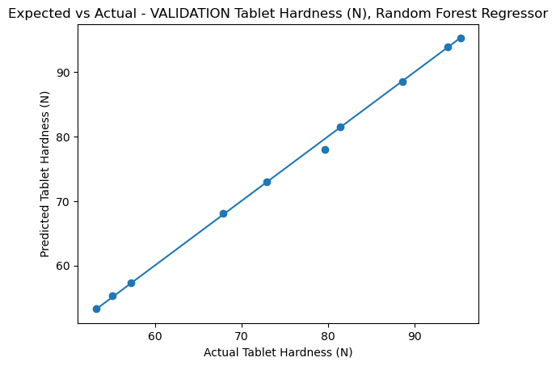
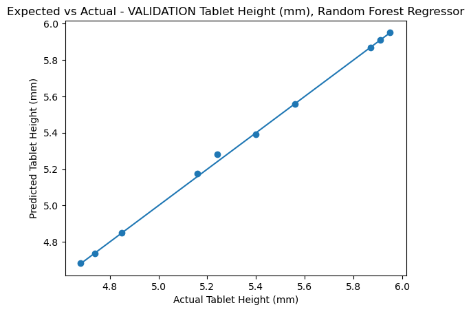
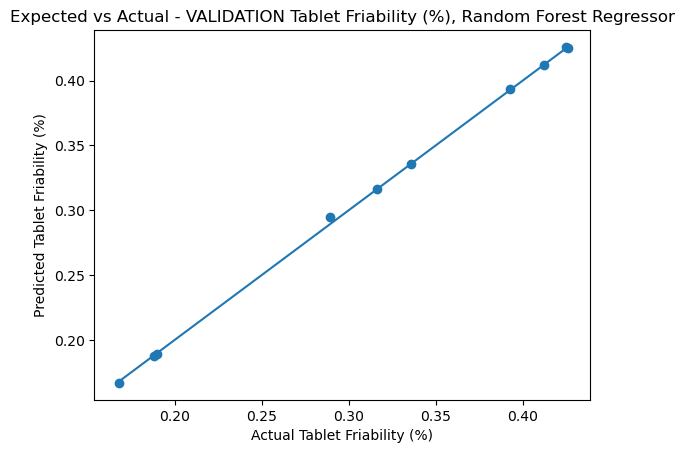

# Predicting Tablet Quality with a Random Forest

A Random Forest regression model that predicts the quality of pharmaceutical tablets from the settings of a tablet press.

This was my part of a group project (course VE3451, University of South-Eastern Norway). The group compared three machine-learning models on the same data; I built and evaluated the **Random Forest** model, which gave the best results. The other two models (Multi-Layer Perceptron and Linear Regression) were built by my teammates and are in the [group repository](https://github.com/tomokat4/VE3451-25H-Group14), together with the group paper.

## What it does

| Inputs (process parameters) | Outputs (tablet characteristics) |
|---|---|
| Press force (kg) | Hardness (N) |
| Motor speed (tablets/min) | Height (mm) |
| Particle size (μm) | Friability (%) |

One multi-output `RandomForestRegressor` (100 trees, `random_state=42`) is trained to predict all three outputs at once.

## Data

`data/tablet_examination.xlsx` has 100 measurements. The same split was used by the whole group:

| Rows | Use |
|---|---|
| 1 – 80 | Training |
| 81 – 90 | Test |
| 91 – 100 | Validation |

The targets are standardised before training and converted back for evaluation. This matters because a multi-output forest picks its splits using the error summed over all outputs, and hardness (tens of newtons) would otherwise outweigh height and friability.

## Results

Results as reported in the group paper:

| Test set | R² | MAE | MSE |
|---|---|---|---|
| Hardness (N) | 0.9995 | 0.2870 | 0.1090 |
| Height (mm) | 0.9988 | 0.0116 | 0.0003 |
| Friability (%) | 0.9996 | 0.0014 | ≈ 0 |

| Validation set | R² | MAE | MSE |
|---|---|---|---|
| Hardness (N) | 0.9987 | 0.2633 | 0.2977 |
| Height (mm) | 0.9990 | 0.0080 | 0.0002 |
| Friability (%) | 0.9996 | 0.0011 | ≈ 0 |

Average validation R² across the three outputs, by model (from the group comparison):

| Model | Average R² |
|---|---|
| **Random Forest** | **0.9991** |
| Multi-Layer Perceptron | 0.9925 |
| Linear Regression | 0.9823 |

Running `random_forest.py` writes your own numbers to `results/metrics.csv`. Small differences in the last digits can occur between scikit-learn versions.

### Predicted vs actual (validation set)





The test-set plots are in `results/` as well. Points close to the line mean the prediction is close to the real measurement.

## Run it yourself

```bash
git clone https://github.com/sulaf29bb-gif/tablet-press-random-forest.git
cd tablet-press-random-forest
pip install -r requirements.txt
python random_forest.py
```

The script prints the scores and feature importances and saves the plots and `metrics.csv` to `results/`.

## Project structure

```
.
├── random_forest.py                # the model, evaluation and plots
├── data/
│   └── tablet_examination.xlsx     # dataset (100 measurements)
├── results/                        # predicted-vs-actual plots (+ metrics.csv after a run)
├── requirements.txt
├── README.md
├── LICENSE
└── .gitignore
```

## Limitations

- The dataset is small: only 10 rows each for testing and validation, so the scores are based on very few samples.
- The split is by row order, not random.
- The scores are close to perfect, which suggests the data is very clean and that the relationship between settings and tablet quality is simple. Results on real production data with more noise would likely be lower.
- Feature importances come from one joint model for all three outputs, not from one model per output.

## Credits

Group project by Group 14 (VE3451-25H). The paper and the other two models are in the group repository linked above. The Random Forest model, evaluation and plots in this repository are my own work.

## License

MIT. See the LICENSE file.
